# FastTable

**A restaurant reservation platform where customers book a table (and pre-order their food), restaurant owners run their own dashboard, and admins approve new restaurants.**

Built as my final project (PAP – *Prova de Aptidão Profissional*) for the Professional Course in IT Systems Management and Programming, 2025.

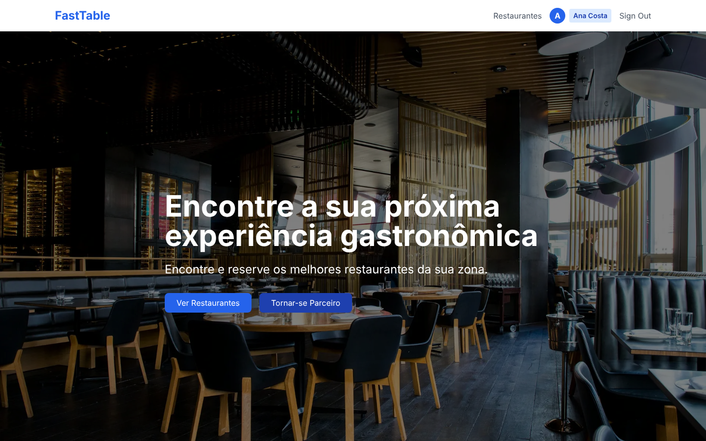

## Tech stack

| Area | Tools |
| --- | --- |
| Framework | Next.js 14 (App Router), React 18, TypeScript |
| Styling | Tailwind CSS |
| Database | PostgreSQL (Supabase) with Prisma ORM |
| Auth | NextAuth.js: email + password (bcrypt) and Google sign-in, JWT sessions, role-based route protection in middleware |
| Email | Nodemailer (account verification) |
| UI extras | Chart.js, drag-and-drop (`@hello-pangea/dnd`), colour picker, Swiper, date-fns |

## Features

### For customers
- Browse and search restaurants by name, address and cuisine
- Restaurant page with details, opening hours and a menu grouped by category
- **4-step booking flow:** choose a table size, pick a date and an available time slot, optionally pre-order dishes, then confirm
- Profile with booking stats, upcoming and past reservations

### For restaurant owners
- Sign-up request that an admin approves or rejects
- Dashboard with today's bookings and 7-day charts for page views and reservations
- **Menu editor:** categories, drag-and-drop ordering, dish photos and a custom theme colour
- Manage reservations, table types, opening hours, booking duration and restaurant details

### For admins
- Platform overview with user and restaurant growth charts
- Approve or reject restaurant requests (approval creates the owner account and the restaurant in one transaction)
- Manage users and restaurants

### Booking engine
Reservations are checked server-side: the API finds existing bookings that overlap the requested time window (based on each restaurant's booking duration), counts tables already in use per table type, and assigns the smallest free table that fits the group. If none is free, the request is rejected with `409 Conflict`.

## Screenshots

| Restaurants | Restaurant page |
| --- | --- |
| 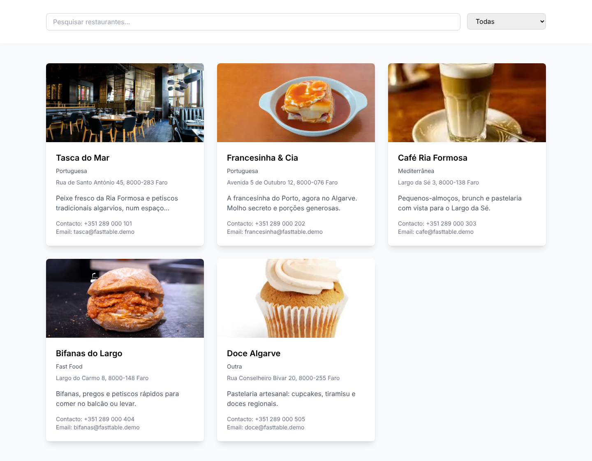 | 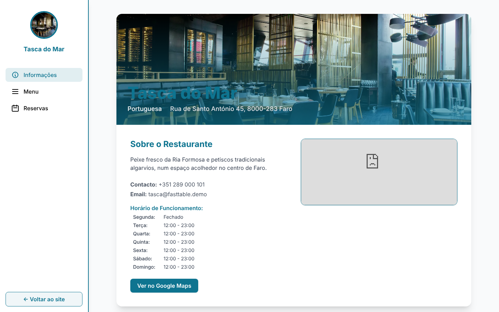 |

| Booking: date & time | Booking: pre-order food | Booking: confirmation |
| --- | --- | --- |
| 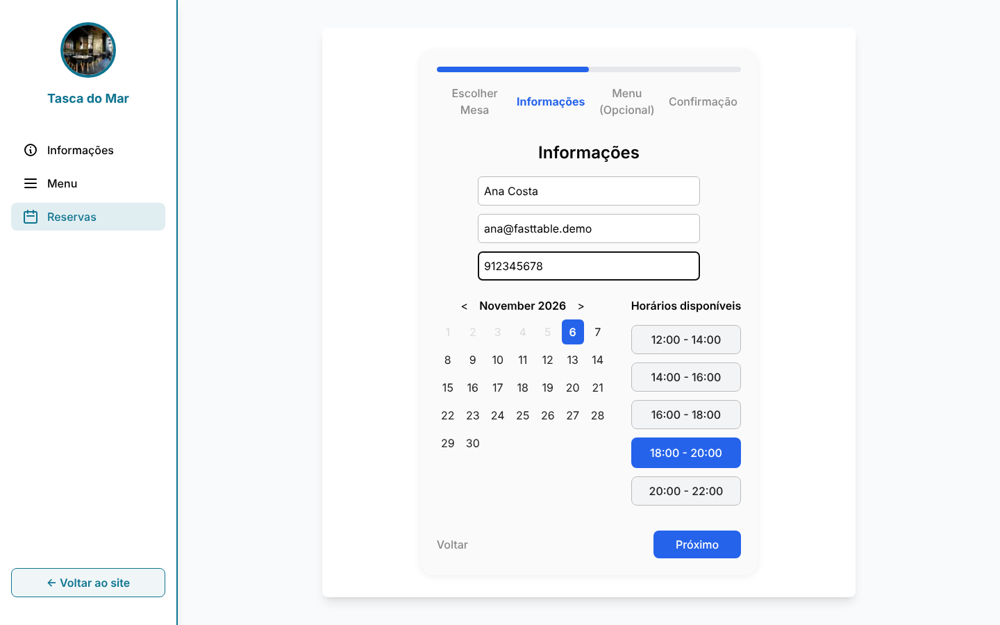 | 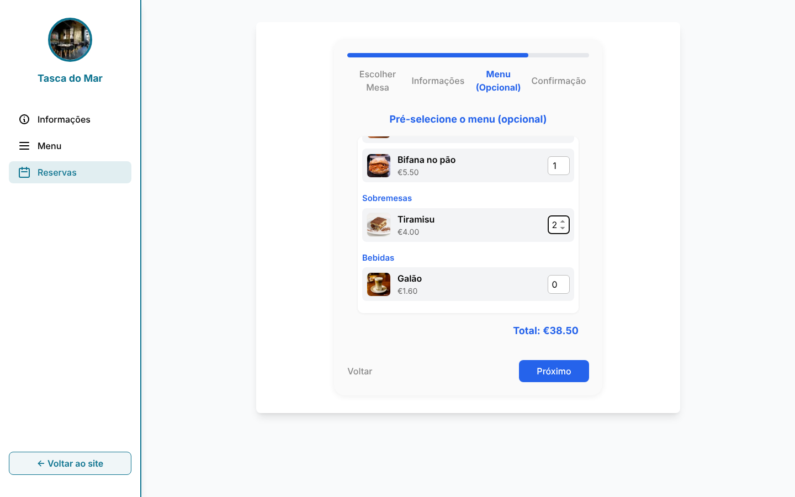 | 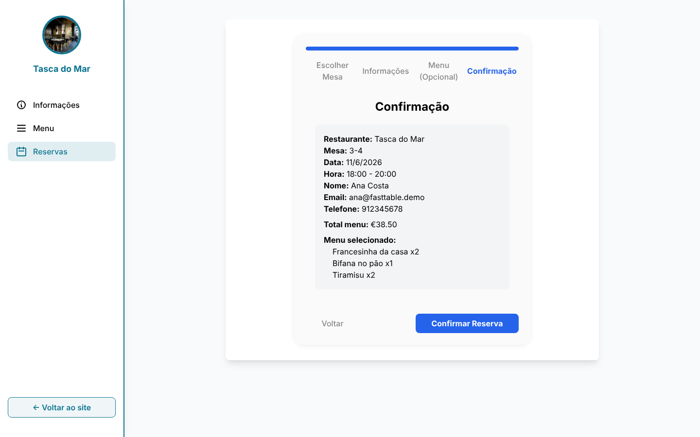 |

| Owner dashboard | Menu editor |
| --- | --- |
| 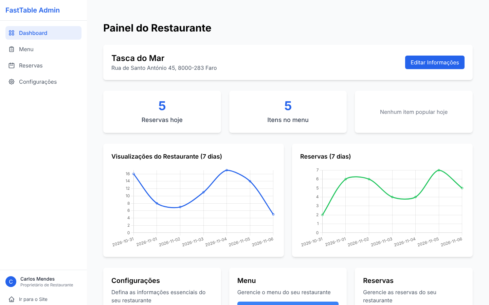 | 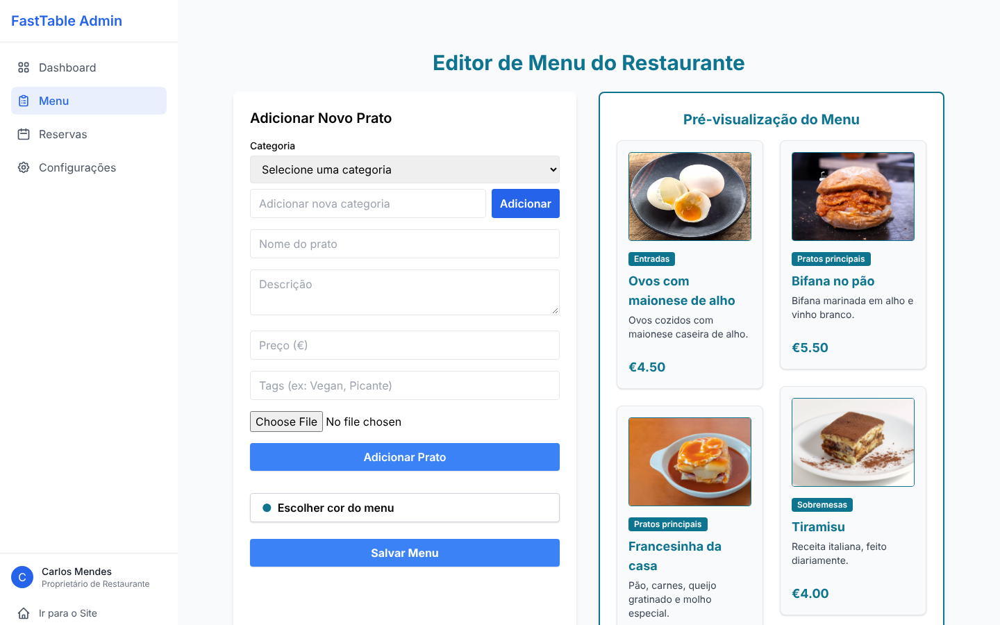 |

| Reservations (owner) | Restaurant settings |
| --- | --- |
| 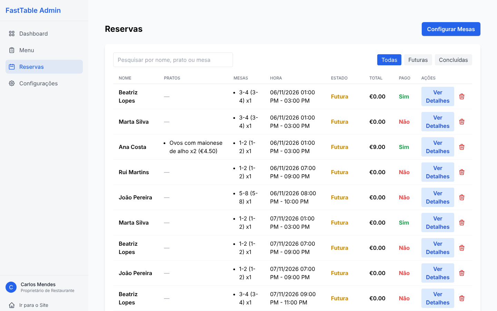 | 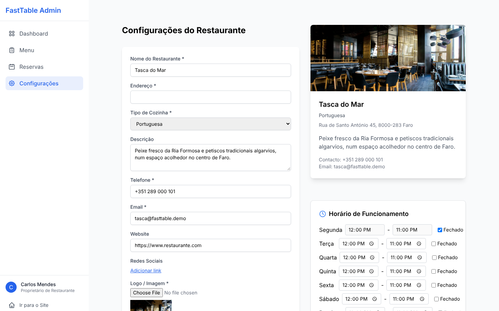 |

| Admin dashboard | Restaurant requests |
| --- | --- |
| 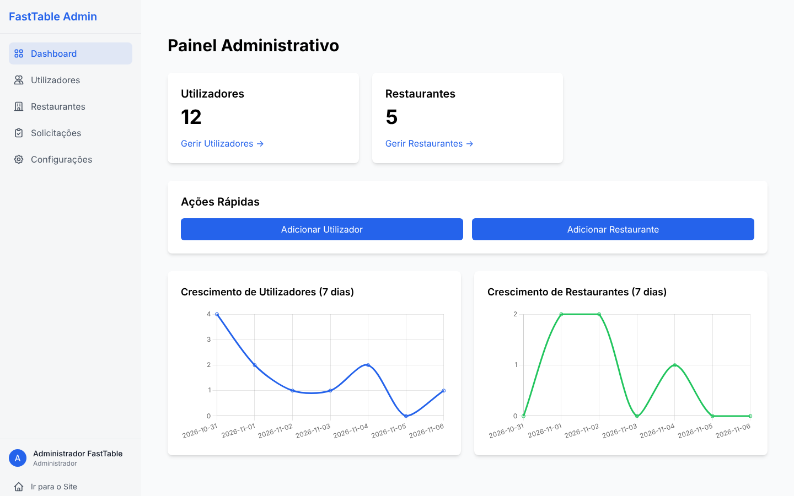 | 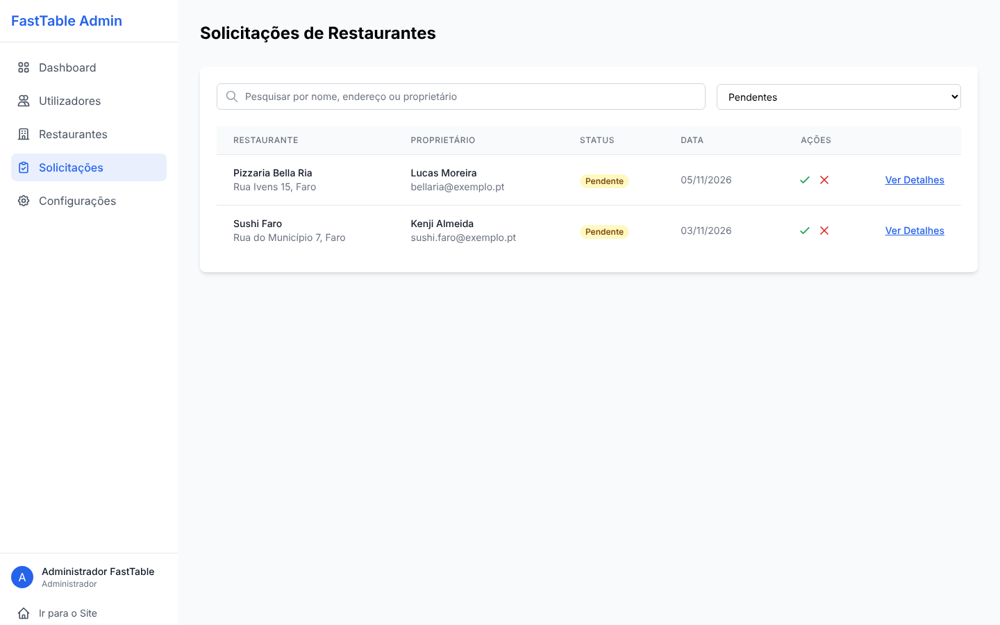 |

| Customer profile | Restaurant sign-up |
| --- | --- |
| 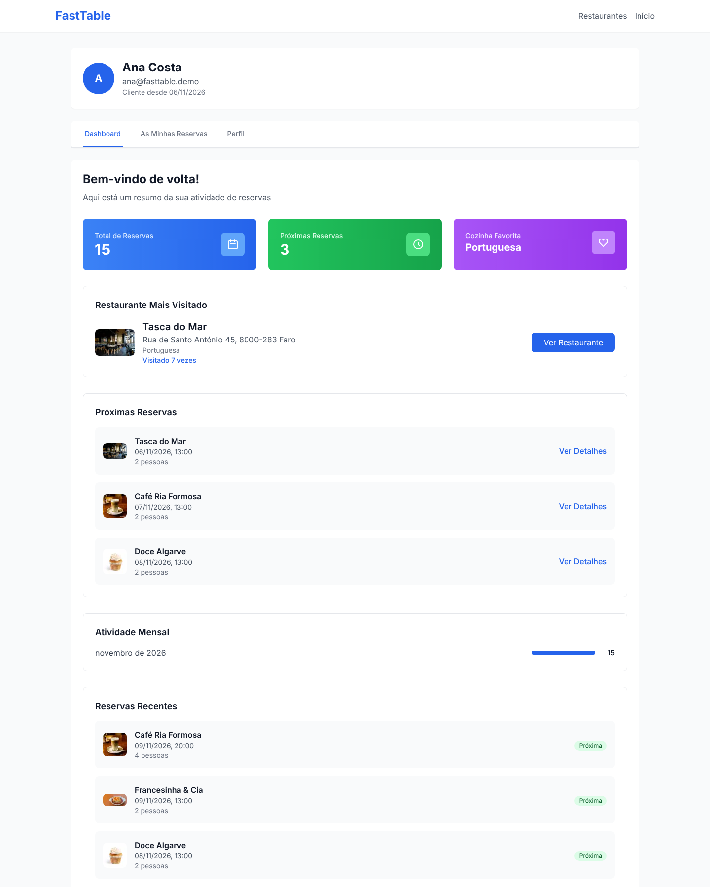 | 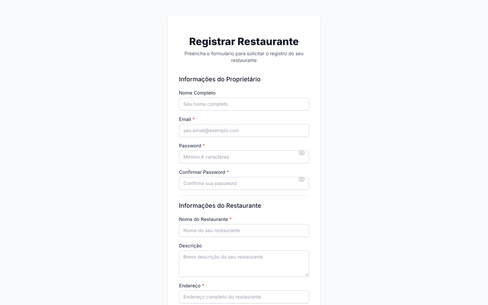 |

*Screenshots use fictional demo data.*

## Running locally

**Requirements:** Node.js 18+ and a PostgreSQL database (local, or a free Supabase project).

```bash
git clone https://github.com/metarima/FastTable.git
cd FastTable
npm install

cp .env.example .env          # then fill in DATABASE_URL and NEXTAUTH_SECRET
npx prisma migrate deploy     # create the tables
npm run dev                   # http://localhost:3000
```

Then open `http://localhost:3000/admin/setup` to create the first admin account.

Google sign-in and SMTP are optional. Without SMTP credentials, new accounts can't receive the verification email, so verify them from the database or sign in with Google.

## Project structure

```
src/
  app/
    api/            REST endpoints (auth, restaurants, reservations, admin, upload)
    admin/          Admin and restaurant-owner dashboards
    restaurants/    Restaurant list, restaurant page and booking flow
    profile/        Customer area
    auth/           Sign-in, sign-up, email verification
  lib/              Prisma client, email sending
  middleware.ts     Role-based route protection
prisma/
  schema.prisma     Data model
  migrations/       Database migrations
```

## Author

**Luís Sousa** · [github.com/metarima](https://github.com/metarima)
